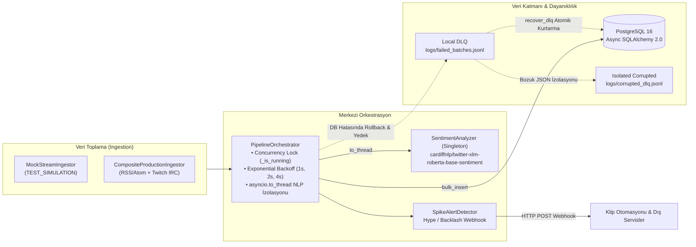

# sentiment-engine

Canlı yayın klip otomasyonu (`stream_chat`), film analiz araçları (`movie_reviews`) ve piyasa tahmin sistemleri (`market_pulse`) için geliştirilmiş; **asenkron veri toplama, Türkçe/İngilizce NLP duygu analizi, Spike/Webhook bildirimleri ve otomatik Dead Letter Queue (DLQ) kurtarma** yeteneklerine sahip bağımsız mikroservis.

---

## Mimari Genel Bakış



---

## Hızlı Başlangıç (Docker Compose)

Tek komutla **PostgreSQL 16** ve **`sentiment-engine`** servisini ayağa kaldırın:

```bash
docker compose up --build -d
```

- **Canlı Görsel Kontrol Paneli (Web Dashboard):** http://localhost:8001/dashboard
- **Swagger UI (OpenAPI Dokümantasyonu):** http://localhost:8001/docs
- **Sistem Sağlık Kontrolü:** http://localhost:8001/api/v1/health

---

## Temel API Uç Noktaları

| Metot | Uç Nokta | Açıklama |
| :--- | :--- | :--- |
| `POST` | `/api/v1/analyze` | Tekil (`text`) veya toplu (`texts`) metinleri anlık analiz eder; etiket (`positive`, `negative`, `neutral`), güven skoru (`0.0 - 1.0`), polarite skoru (`-1.0 - 1.0`) ve süreyi (`ms`) döndürür. |
| `GET` | `/api/v1/sentiment/{topic}` | Belirli bir konu (`stream_chat`, `movie_reviews`, `market_pulse`) için son **5 dakikalık** ve **1 saatlik** hareketli ortalamaları, mesaj hacmini ve dakikalık zaman serisini döndürür. |
| `POST` | `/api/v1/simulation/trigger` | Belirli bir konuda pozitif/negatif/nötr yönde anlık sentetik veri patlaması (spike) tetikler. |
| `GET` | `/api/v1/alerts` | Algılanan son duygu patlamalarını (hype / backlash) ve kayıtlı webhook adreslerini listeler. |
| `POST` | `/api/v1/alerts/webhooks` | Ani duygu patlamalarında otomatik `POST` bildirimi alacak dış servis (örn. klip otomasyonu) webhook URL'sini kaydeder. |
| `POST` | `/api/v1/orchestrator/recover-dlq` | `logs/failed_batches.jsonl` dosyasındaki kayıtları PostgreSQL'e manuel kurtarır. |
| `GET` | `/api/v1/health` | PostgreSQL bağlantısı, APScheduler worker durumu, DLQ bekleyen kayıt sayısı ve NLP model durumunu döndürür. |

---

## Diğer Projeleriniz İçin Entegrasyon Örnekleri (Python `httpx`)

### 1. Canlı Yayın Klip Otomasyonu Entegrasyonu (Webhook + `stream_chat`)
Klip otomasyon servisinizin, sohbette ani bir **pozitif hype** veya **negatif tepki** patlaması olduğunda otomatik tetiklenmesi için webhook kaydedin:

```python
import httpx

SENTIMENT_ENGINE_URL = "http://localhost:8001"

async def setup_clip_webhook():
    async with httpx.AsyncClient(base_url=SENTIMENT_ENGINE_URL) as client:
        # 1. Klip servisinizin webhook adresini kaydedin
        await client.post(
            "/api/v1/alerts/webhooks",
            json={"url": "http://clip-automation-service:9000/webhooks/hype-spike"},
        )

        # 2. İsterseniz canlı yayın sohbetinin son 5 dakikalık hype ortalamasını sorgulayın
        resp = await client.get("/api/v1/sentiment/stream_chat")
        stats = resp.json()
        if stats["window_5m"]["moving_avg_sentiment"] > 0.60:
            print("Yüksek Hype! Klip tetikleniyor...")
```

### 2. Film Analiz Araçları Entegrasyonu (`POST /api/v1/analyze`)
```python
import httpx

async def analyze_movie_reviews(reviews: list[str]):
    async with httpx.AsyncClient(base_url="http://localhost:8001") as client:
        resp = await client.post(
            "/api/v1/analyze",
            json={
                "texts": reviews,
                "topic": "movie_reviews",
                "source": "movie_analyzer_app",
                "persist": True,
            },
        )
        return resp.json()
```

### 3. Piyasa Tahmin Sistemleri Entegrasyonu (`GET /api/v1/sentiment/market_pulse`)
```python
import httpx

async def get_market_sentiment_signal():
    async with httpx.AsyncClient(base_url="http://localhost:8001") as client:
        resp = await client.get("/api/v1/sentiment/market_pulse")
        data = resp.json()
        return {
            "ma_5m": data["window_5m"]["moving_avg_sentiment"],
            "ma_1h": data["window_1h"]["moving_avg_sentiment"],
            "volume_1h": data["window_1h"]["message_volume"],
        }
```

---

## Çalışma Modları ve Güvenlik (`.env`)

- **`WORK_MODE=TEST_SIMULATION` (Varsayılan):** `MockStreamIngestor` ile her 10 saniyede bir gerçekçi Türkçe/İngilizce Twitch/Kick sohbeti, film yorumu ve piyasa başlığı üretir.
- **`WORK_MODE=PRODUCTION`:** `CompositeProductionIngestor` devreye girer; `MARKET_RSS_URLS`, `MOVIE_RSS_URLS` üzerinden gerçek RSS/Atom beslemelerini ve `TWITCH_CHANNEL` tanımlıysa anonim Twitch IRC sohbetini canlı dinler.
- **`API_KEY` Güvenliği:** `.env` içinde `API_KEY=gizli-anahtar` tanımlandığında yazma/analiz uç noktaları `X-API-Key: gizli-anahtar` başlığını zorunlu tutar. Boş bırakıldığında geliştirme kolaylığı için açık çalışır.

---

## Testler ve Yük Simülasyonu

```bash
# Birim, Orkestratör/DLQ, Spike Alert ve API Entegrasyon Testleri
docker compose exec sentiment-engine pytest

# Yüksek Hacimli Eşzamanlı Stres ve DB Tutarlılık Testi
docker compose exec sentiment-engine python scripts/simulate_load.py --base-url http://localhost:8001
```
